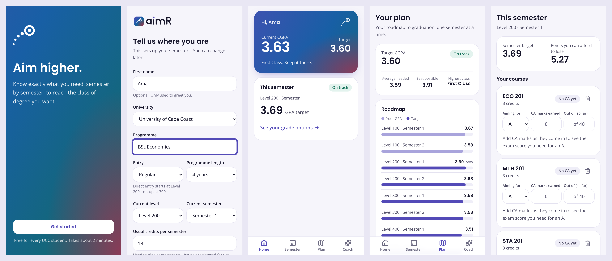

# aimR

aimR helps university students plan, track and reach their GPA and CGPA targets, semester by
semester, starting with the University of Cape Coast. Tagline: *aimR: aim higher.*



Watch the 44-second walkthrough: [docs/aimr-walkthrough.mp4](docs/aimr-walkthrough.mp4)

## Repository layout

| Path | What it is |
|---|---|
| `packages/engine` | `@aimr/engine`: the deterministic planning engine (pure TypeScript, no AI). GPA/CGPA, class of degree, feasibility, the semester-by-semester plan, points budget, grade combinations, exam score needed. Rules per university are data (`src/rules.ts`). |
| `apps/web` | `@aimr/web`: the Next.js 16 web app (mobile-first, installable). |
| `apps/web/public/brand` | The logo set and its usage guide. |

## Run it

Needs Node 22+ and pnpm 10.

```bash
pnpm install
pnpm dev        # http://localhost:3000
pnpm test       # engine tests
pnpm build
```

## Status

Phase 1, free launch setup (product doc section 8.1). Working now:

- Onboarding, results entry by hand or from a screenshot (Tesseract.js on the device; the image
  is never uploaded), CGPA and class of degree.
- Targets with a feasibility check, the front-loaded semester plan, points budget and grade options.
- CA tracking per course: exam score needed, status, likely grade range, semester outlook.
- Results day: final grades become results, the student moves on, the plan re-spreads.
- Installable and offline after the first visit (service worker in `apps/web/public/sw.js`).

Data is stored on the device (localStorage) for now. Next: Supabase accounts and sync, coaching,
the Ask aimR assistant.

## Open questions to confirm with UCC before launch

The engine's cautious defaults are in `packages/engine/src/rules.ts`:

- **Resits:** default is that both attempts count (never overstates a CGPA).
- **Rounding at class boundaries:** default is no rounding (3.595 is Second Class Upper).
- **CA/exam split:** 40/60 placeholder.
- **Courses excluded from the CGPA:** students can mark a course as excluded.
